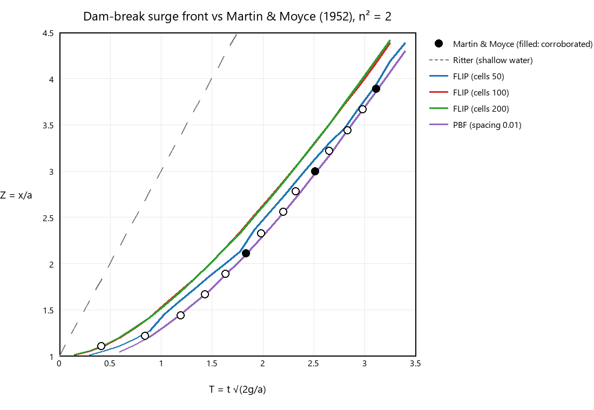

# Dam-break validation: Martin & Moyce (1952)



## The experiment

A water column of width *a* and height 2*a* (n² = 2) is released at one end of a dry,
flat tank. The surge front's position Z = x/*a* is reported against dimensionless time
T = t·√(2g/*a*), as ensemble means of repeated runs.

The circles are the values as commonly reproduced in SPH/MPS validation papers. Three of
them, filled in the plot, are corroborated against published validations, which quote
Martin & Moyce's Table 2 as the front reaching Z = 2.11, 3.00 and 3.89 at T = 1.83, 2.51
and 3.11: an [interFoam case](https://github.com/yujieteo/femahoy/pull/125) and an
[SPH case](https://github.com/trdillman/warp_sph_realtime/pull/11). Those are project
notes rather than peer-reviewed sources, and the original paper wasn't checked, so treat
the open circles as approximate. The regression test uses only the three filled points.

The dashed line is Ritter's shallow-water solution for a dry bed, Z = 1 + 2T. It
neglects the initial vertical acceleration and is known to overpredict the front.

## The simulation

Preset "Martin & Moyce column": *a* = 0.25 m, the column measured from the actual wall
and floor faces, in a 2 × 1 m tank. The front is the 99.9th-percentile x of particles in
a 2 cm band along the floor, so stray spray droplets don't count.

| Run | Particles | T at Z = 2.11 (exp. 1.83) | T at Z = 3.00 (exp. 2.51) | T at Z = 3.89 (exp. 3.11) |
|---|---|---|---|---|
| FLIP, 50 cells | 1.2k | 1.75 (−4%) | 2.41 (−4%) | 3.08 (−1%) |
| FLIP, 100 cells (default) | 5k | 1.58 (−14%) | 2.29 (−9%) | 2.92 (−6%) |
| FLIP, 200 cells | 20k | 1.58 (−14%) | 2.29 (−9%) | 2.91 (−7%) |
| PBF, 0.01 m spacing | 1.2k | 1.84 (+1%) | 2.53 (+1%) | 3.13 (+1%) |

## What it shows

- **FLIP is grid-converged.** 100 and 200 cells give identical curves, so the
  difference from the data is systematic, not a resolution error.
- **The difference is a near-constant time offset, not a speed error.** Converged FLIP
  reaches each position about ΔT ≈ 0.2 early (0.023 s in real time). Its front speed
  between Z = 3.00 and 3.89 is dZ/dT = 1.44, against the experiment's 1.48, within 3%. A
  constant lead is what a finite gate-opening time in the experiment would produce; it
  is the usual explanation for inviscid simulations running ahead of this data early on.
- **The closer matches are partly luck.** The coarse FLIP run and PBF land within 1–4%
  largely because coarse resolution and viscosity slow the front: numerical
  dissipation happens to mimic the experiment's delay. That isn't better physics.
- **Ritter's solution is far too fast**, as expected.

`crates/sim/tests/validation.rs` keeps this as a regression test. For both FLIP and
PBF, arrival times must stay within 15% of the corroborated points (allowing the offset)
and the front speed within 10%.

## Reproduce

```bash
cargo run -p bench --release -- --solver flip --preset martin --frames 30 --set cells_y=100 --front-csv docs/validation/flip_cells_y100.csv
```

```bash
python tools/plot_dam_break.py docs/validation/flip_cells_y50.csv docs/validation/flip_cells_y100.csv docs/validation/flip_cells_y200.csv docs/validation/pbf_spacing0p01.csv -o docs/validation/dam_break.png
```

The plot script needs only Pillow. Filenames use `p` for the decimal point
(`pbf_spacing0p01.csv` is labelled "spacing 0.01").
